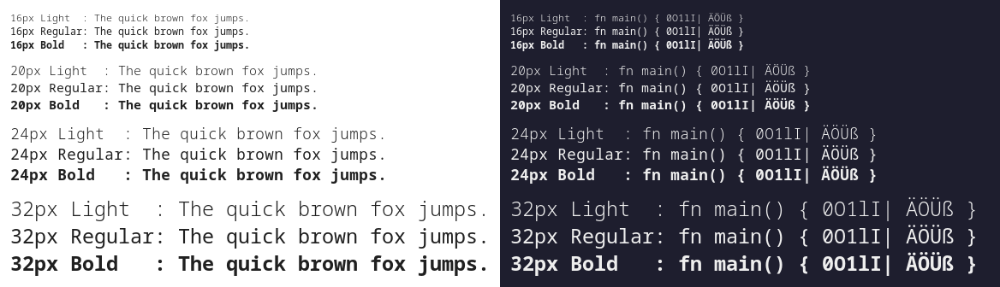

+++
title = "This Month in Rust OSDev: October 2026"
date = 2026-11-05

[extra]
month = "October 2026"
editors = ["phil-opp"]
+++

Welcome to a new issue of _"This Month in Rust OSDev"_. In these posts, we give a regular overview of notable changes in the Rust operating system development ecosystem.

<!-- more -->

This series is openly developed [on GitHub](https://github.com/rust-osdev/homepage/). Feel free to open pull requests there with content you would like to see in the next issue. If you find some issues on this page, please report them by [creating an issue](https://github.com/rust-osdev/homepage/issues/new) or using our <a href="#comment-form">_comment form_</a> at the bottom of this page.

Please submit interesting posts and projects for the next issue by commenting on the [draft pull request](https://github.com/rust-osdev/homepage/pulls) or via a PR [on GitHub](https://github.com/rust-osdev/homepage/).

Disclaimer: Automated scripts and AI assistance were used for collecting and categorizing links.
Everything was proofread and checked manually, with many manual tweaks.

<!--
    This is a draft for the upcoming "This Month in Rust OSDev (October 2026)" post.
    Feel free to create pull requests against the `next` branch to add your
    content here.
    Please take a look at the past posts on https://rust-osdev.com/ to see the
    general structure of these posts.
-->

## Announcements, News, and Blog Posts

Here we collect news, blog posts, etc. related to OS development in Rust.

<!--
Please follow this template:

- [Title](https://example.com)
  - (optional) Some additional context
-->

### OS Projects

- [Announcing Asterinas 0.19.0](https://asterinas.github.io/2026/10/13/announcing-asterinas-0.19.0.html)
  - [Asterinas](https://github.com/asterinas/asterinas) is a Linux ABI-compatible OS kernel written from scratch in Rust.
  - 0.19.0 adds a DRM subsystem (Xorg and 3D games), AArch64 as its fourth architecture, Intel VMX hypervisor support in OSTD, a Rust-native device model, and self-hosting builds.
- [Driving an NVIDIA GPU from a hobby Rust kernel: GSP-RM to Vulkan](https://github.com/oriaj-nocrala/rust_so_kernel/blob/master/docs/blog/gsp-to-vulkan.md)
  - The `no_std` UEFI hobby kernel [constanos](https://github.com/oriaj-nocrala/rust_so_kernel) now boots NVIDIA's GSP-RM firmware on an RTX 3050 and runs a port of Mesa's NVK, so unmodified Vulkan code renders without Linux underneath.
  - Most of the code was written by Claude Code, with the author directing the work and running the hardware tests.
- [Tock](https://www.tockos.org/), a secure embedded operating system for microcontrollers written in Rust:
  - [Tock 2.3.0](https://github.com/tock/tock/releases/tag/release-2.3.0): The first Tock release since early 2025 adds initial 64-bit RISC-V and x86 support, dynamic process loading, 8 new boards, and many soundness and MPU security fixes.
  - [Talking Tock 66: RISC-V 64-bit Support on Tock](https://www.tockos.org/blog/2026/talking-tock-66/)
  - [Talking Tock 65: Unsafe Documentation in the Core Tock Kernel](https://www.tockos.org/blog/2026/talking-tock-65/): Tock's core kernel crate now denies `clippy::missing_safety_doc` and `clippy::undocumented_unsafe_blocks`.
- [Redox OS](https://www.redox-os.org/), a Unix-like microkernel operating system written in Rust:
  - [This Month in Redox - September 2026](https://www.redox-os.org/news/this-month-260930/)
  - [Ring Buffers Project Summary](https://www.redox-os.org/news/nlnet-rb-summary/): Wrap-up of Redox's NLnet-funded work on io_uring-like ring buffer support.
- [Microsoft Issues First Release Of Their LiteBox Sandboxing Library OS](https://www.phoronix.com/news/Microsoft-LiteBox-0.1)
- [The Documentation I Wish I Had: How I build drivers for Open Nexus OS](https://open-nexus-os.io/blog/the-documentation-i-wish-i-had)
  - Bringing up the Rust microkernel OS [Open Nexus OS](https://github.com/open-nexus-OS/open-nexus-OS) on a Banana Pi BPI-F3: measuring the vendor's Linux system first and turning those measurements into pass/fail gates that drive the display, USB, and GPU driver work.
  - A large part of Open Nexus OS was built with AI coding agents, guided by the measured gates described in the post.
- [Ginux](https://github.com/gmkurtzer/ginux)
  - A userspace kernel that runs as an ordinary process on top of Linux and gives each workload a deliberately reduced, versioned subset of the Linux ABI by emulating, mediating, or denying its syscalls.
  - Ginux started as a standalone Rust kernel booting through UEFI and running a Rocky Linux userspace (preserved on the [`bootable-kernel`](https://github.com/gmkurtzer/ginux/tree/bootable-kernel) branch).
  - Both versions were written by an AI coding agent directed by the author.

### Linux-related

- [17k Lines Of New Rust Kernel Code Heading Into Linux 7.4](https://www.phoronix.com/news/Linux-7.4-Rust)
- [Google's C Binder Driver Removed With Rust Binder Ready For "Few Billion Devices"](https://www.phoronix.com/news/Linux-7.4-Char-Misc)
  - Follow-up to last month's item: the removal has now been merged for Linux 7.4.
- [Upstreaming Tyr: Rust, DRM, and the Linux Kernel](https://www.collabora.com/news-and-blog/blog/2026/10/21/upstreaming-tyr-rust-drm-and-the-linux-kernel/)
  - Progress on upstreaming Tyr, the Rust DRM driver for Arm Mali GPUs.
- [NVIDIA's Nova Driver Continues Leading The Way For Linux Rust GPU Drivers](https://www.phoronix.com/news/NVIDIA-Nova-Linux-7.4-Changes)
- [Nova Driver Continues Progressing With Long-Term Goal For Official NVIDIA Linux Use](https://www.phoronix.com/news/Nova-Driver-LPC-2026)
  - Coverage of the LPC 2026 talk on the Rust Nova driver stack.
- LWN coverage of [Kangrejos 2026](https://kangrejos.com), the Rust for Linux workshop:
  - [Owning C types from Rust code](https://lwn.net/Articles/1099015/)
  - [Safe self-referential data structures in kernel Rust](https://lwn.net/Articles/1099224/)
  - [Cross-crate forward declarations in Rust](https://lwn.net/Articles/1099596/)
  - [Discussing a rewrite of XArray](https://lwn.net/Articles/1100520/)
  - [Rust features in the future](https://lwn.net/Articles/1099606/)
  - [Guidelines for panics in kernel code](https://lwn.net/Articles/1100873/)

### Embedded and Tooling

- [Using TrustZone-M in Rust on the Raspberry Pi Pico 2](https://tweedegolf.nl/en/blog/241/using-trustzone-m-in-rust-on-the-raspberry-pi-pico-2/)
- [Finding panics with Call Graph Analyzer](https://tweedegolf.nl/en/blog/242/finding-panics-with-call-graph-analyzer/)
  - A tool that extracts the call graph from monomorphized MIR to find which functions in a firmware binary can panic.
- [Wild 0.11.0](https://github.com/wild-linker/wild/releases/tag/0.11.0)
  - The Rust-based Wild linker gained considerably better linker script support and a Wasm port.
- [The Embedded Rustacean Issue #82](https://www.theembeddedrustacean.com/p/the-embedded-rustacean-issue-82)
  and [Issue #83](https://www.theembeddedrustacean.com/p/the-embedded-rustacean-issue-83)

## Infrastructure and Tooling

In this section, we collect recent updates to `rustc`, `cargo`, and other tooling that are relevant to Rust OS development.

<!--
    Please use the following template:

- [Title](https://example.com)
  - (optional) Some additional context
-->

### Breaking Changes and Warnings

- [FCW (future-compatibility warning) for `#[panic_handler]` on `unsafe fn`.](https://github.com/rust-lang/rust/pull/162974)
  - The compiler can call the panic handler from anywhere, so declaring it as `unsafe fn` is going to become an error.
- [Deny partial `-Z stack-protector` by default in all editions](https://github.com/rust-lang/rust/pull/157941)
  - Enabling stack protection for only some crates of a binary now triggers a future-compatibility warning unless `-Z allow-partial-mitigations=stack-protector` is passed ([RFC 3855](https://github.com/rust-lang/rfcs/pull/3855)).
- [Remove some #[linkage] options](https://github.com/rust-lang/rust/pull/163405)
  - The unstable `#[linkage]` attribute no longer accepts `common`, `external`, or `internal`.
- [Nuke `Unique` (and `ptr_internals`)](https://github.com/rust-lang/rust/pull/164146)
  - Removes the internal `core::ptr::Unique` type and the `ptr_internals` feature, which some older nightly kernel code still uses.

### Library Stabilizations

The following APIs were stabilized this month and are expected to be available in Rust 1.101:

- [`<*const T>::try_cast_aligned`](https://doc.rust-lang.org/nightly/core/primitive.pointer.html#method.try_cast_aligned), [`<*mut T>::try_cast_aligned`](https://doc.rust-lang.org/nightly/core/primitive.pointer.html#method.try_cast_aligned-1), and [`NonNull::try_cast_aligned`](https://doc.rust-lang.org/nightly/core/ptr/struct.NonNull.html#method.try_cast_aligned)
  - Checked pointer casts that return `None` if the pointer is not aligned for the target type.
  - Stabilization PR: [Stabilize `ptr::try_cast_aligned`](https://github.com/rust-lang/rust/pull/154170)
- [`<*const T>::cast_slice`](https://doc.rust-lang.org/nightly/core/primitive.pointer.html#method.cast_slice), [`<*mut T>::cast_slice`](https://doc.rust-lang.org/nightly/core/primitive.pointer.html#method.cast_slice-1), and [`NonNull::cast_slice`](https://doc.rust-lang.org/nightly/core/ptr/struct.NonNull.html#method.cast_slice)
  - Postfix versions of `ptr::slice_from_raw_parts{_mut}` that turn a pointer and a length into a slice pointer.
  - Stabilization PR: [stabilize ptr_cast_slice](https://github.com/rust-lang/rust/pull/162927)
- [`vec::IntoIter::allocator`](https://doc.rust-lang.org/nightly/alloc/vec/struct.IntoIter.html#method.allocator), together with the allocator parameter of `vec::IntoIter<T, A>`
  - A follow-up to last month's `Allocator` stabilization.
  - Stabilization PR: [vec: stabilise allocators for into_iter](https://github.com/rust-lang/rust/pull/163499)

### Unstable `core` APIs

- [core: Rename `abort_immediate` to `crash`](https://github.com/rust-lang/rust/pull/164730)
  - Renames the single-instruction abort in `core::process`, which also works without an OS or libc. Stabilizing it as `crash` is proposed in [#164731](https://github.com/rust-lang/rust/pull/164731).
- [add core::process::resumable_breakpoint](https://github.com/rust-lang/rust/pull/163611)
  - An unstable breakpoint function in `core` that is documented as safe to continue past. See the [Zulip discussion](https://rust-lang.zulipchat.com/#narrow/channel/219381-t-libs/topic/Pushing.20.60breakpoint.60.20over.20the.20finish.20line.3F/near/628514482) for background.

### Target Support

- [aarch64: Use neon registers for ABI on targets that require `neon"](https://github.com/rust-lang/rust/pull/163824)
  - The aarch64 version of last month's x86 SSE change: on hard-float aarch64 targets, vectors are now passed in NEON registers and disabling the `neon` target feature is a hard error. Kernels that disable NEON need a soft-float target such as `aarch64-unknown-none-softfloat`.
- [tier 3 target policy: target CPU and features must be supported by upstream backend](https://github.com/rust-lang/rust/pull/162840)
  - New tier 3 targets must use CPU and feature names that upstream LLVM recognizes.
- [Add aarch64-unknown-qtee as a tier 3 target](https://github.com/rust-lang/rust/pull/163688)
  - A new target for Qualcomm's Trusted Execution Environment (QTEE).
- [Add the `movdir64b` and `movdiri` x86 target features](https://github.com/rust-lang/rust/pull/163742)
  - Adds unstable target features for x86 direct-store instructions, which are used to submit work to devices through MMIO.
- [Fix RISC-V inline ASM `clobber_abi` when extra target features are enabled](https://github.com/rust-lang/rust/pull/163833)
  - Fixes which registers `clobber_abi("C")` clobbers for the `ilp32e`/`lp64e` ABIs and for floating-point registers.

### Cargo

- [feat(build-std): Add build.build-std.when and crates config keys](https://github.com/rust-lang/cargo/pull/17602)
  - Adds the config keys proposed in the [`build-std=always` RFC](https://rust-lang.github.io/rfcs/3874-build-std-always.html) (not functional yet). Related: [builtin package ID spec parsing](https://github.com/rust-lang/cargo/pull/17539) (`builtin://.#core`) for [RFC 3875](https://rust-lang.github.io/rfcs/3875-build-std-explicit-dependencies.html).

## `rust-osdev` Projects

In this section, we give an overview of notable changes to the projects hosted under the [`rust-osdev`](https://github.com/rust-osdev/about) organization.

<!--
    Please use the following template:

    ### [`repo_name`](https://github.com/rust-osdev/repo_name)
    Maintained by [@maintainer_1](https://github.com/maintainer_1)

    The `repo_name` crate ...<<short introduction>>...

    We merged the following changes this month:
    <<changelog, either in list or text form>>
-->

### [`uart_16550`](https://github.com/rust-osdev/uart_16550)
Maintained by [@phip1611](https://github.com/phip1611)

_Simple yet highly configurable low-level driver for 16550 UART devices,
typically known and used as serial ports or COM ports._

[`v0.9.0`](https://github.com/rust-osdev/uart_16550/commit/492c16b2ed81020cb51e302ba7056481db69ac2c)
makes the driver considerably more robust on real hardware. The driver is now
tested against a model of a 16550A that follows the flows of the Linux 8250
driver. The model was created with LLM assistance and careful human review, and
it found 12 bugs, all fixed in this release. Most notably, devices without
working FIFOs, such as the 16450, overran the transmitter and hung the loopback
self-test that `Uart16550Tty` always runs. Also, internal register reads lost
line errors and modem status changes, which `lsr()` and `msr()` now report.

The `Backend` trait is no longer sealed, so users can bring their own register
access, e.g., port I/O via `tdcall` or the GHCB in confidential VMs. Together
with the new `const fn` constructors, devices can now live in a `static`. The
driver also gained `enable_interrupts()` and `disable_interrupts()`, e.g., for
interrupt-driven transmission.

The release comes with several breaking changes, most notably a new MSRV of
1.91, a smaller `Backend` trait with only `read()` and `write()`, and
`calc_divisor()` reporting divisors that don't fit into 16 bits instead of
panicking. The
[changelog](https://github.com/rust-osdev/uart_16550/blob/main/CHANGELOG.md)
has all details.

As mentioned in previous issues, [Anthropic](https://www.anthropic.com/)
sponsors @phip1611 with a Max plan as part of their open source program. The
16550A model and the testing above happened under that sponsorship, and we are
happy that it helps us improve the robustness and reliability of the ecosystem.

We merged the following PRs this month:

- [Allow custom backends (e.g., TDX/SNP port I/O) and const construction](https://github.com/rust-osdev/uart_16550/pull/76)
- [Make port I/O and MMIO constructors const](https://github.com/rust-osdev/uart_16550/pull/77)
- [Make the Backend trait offset-based](https://github.com/rust-osdev/uart_16550/pull/79)
- [Split the backend out of config()](https://github.com/rust-osdev/uart_16550/pull/80)
- [Add Uart16550Tty::new_mmio_from_address() and Uart16550::backend_mut(), document register offset checks](https://github.com/rust-osdev/uart_16550/pull/82)
- [Test the driver against a 16550A model, following Linux](https://github.com/rust-osdev/uart_16550/pull/83)
- [Small fixes found by testing against a 16550A model](https://github.com/rust-osdev/uart_16550/pull/84)
- [Report divisors that don't fit into 16 bits instead of panicking](https://github.com/rust-osdev/uart_16550/pull/85)
- [Add enable_interrupts() and disable_interrupts()](https://github.com/rust-osdev/uart_16550/pull/86)
- [Keep LSR and MSR status across internal reads, like Linux](https://github.com/rust-osdev/uart_16550/pull/87)
- [Detect whether the FIFOs are really enabled](https://github.com/rust-osdev/uart_16550/pull/88)
- [Make the loopback test robust](https://github.com/rust-osdev/uart_16550/pull/89)
- [Inline ISR::interrupt_type() and InterruptType::from_bits()](https://github.com/rust-osdev/uart_16550/pull/93)
- [doc: drop remarks about const fn and statics](https://github.com/rust-osdev/uart_16550/pull/81)
- [Fix misleading statements in the docs](https://github.com/rust-osdev/uart_16550/pull/94)
- [Streamline the changelog for v0.9.0](https://github.com/rust-osdev/uart_16550/pull/92)

<!-- Chore PRs: -->
<!-- - [build(deps): bump uefi from 0.40.0 to 0.41.0 in /real-hw-test](https://github.com/rust-osdev/uart_16550/pull/75) -->
<!-- - [build(deps): bump crate-ci/typos from 1.50.2 to 1.50.3](https://github.com/rust-osdev/uart_16550/pull/74) -->
<!-- - [CI Improvements](https://github.com/rust-osdev/uart_16550/pull/78) -->
<!-- - [Add missing SPDX license headers](https://github.com/rust-osdev/uart_16550/pull/90) -->
<!-- - [build(deps): bump crate-ci/typos from 1.50.3 to 1.51.1](https://github.com/rust-osdev/uart_16550/pull/95) -->
<!-- - [real-hw-test: fix aarch64 QEMU smoke test on Ubuntu 26.04](https://github.com/rust-osdev/uart_16550/pull/96) -->

### [`x86_64`](https://github.com/rust-osdev/x86_64)
Maintained by [@phil-opp](https://github.com/phil-opp), [@josephlr](https://github.com/orgs/rust-osdev/people/josephlr), and [@Freax13](https://github.com/orgs/rust-osdev/people/Freax13)

The `x86_64` crate provides various abstractions for `x86_64` systems, including wrappers for CPU instructions, access to processor-specific registers, and abstraction types for architecture-specific structures such as page tables and descriptor tables.

We merged the following changes this month:

- [feat(addr): add 57-bit and runtime-validated `VirtAddr` types](https://github.com/rust-osdev/x86_64/pull/605)
- [Add checked arithmetic functions to addresses, pages, and frames](https://github.com/rust-osdev/x86_64/pull/616)
- [feat(instructions): Add `lldt` and `sldt`](https://github.com/rust-osdev/x86_64/pull/621)
- [Make mxcsr::write and mxcsr::update unsafe](https://github.com/rust-osdev/x86_64/pull/627)
- [Don't panic when displaying a page tables with pages directly before and after the address gap](https://github.com/rust-osdev/x86_64/pull/617)
- [Document the virtualization exception](https://github.com/rust-osdev/x86_64/pull/624)

Thanks to [@aarkegz](https://github.com/aarkegz), [@mkroening](https://github.com/mkroening), [@adityuhkapoor](https://github.com/adityuhkapoor), [@Garfield1002](https://github.com/Garfield1002), and [@llp42](https://github.com/llp42) for their contributions!

### [`acpi`](https://github.com/rust-osdev/acpi)
Maintained by [@IsaacWoods](https://github.com/IsaacWoods)

The `acpi` repository contains crates for parsing the ACPI tables – data structures that the firmware of modern computers uses to relay information about the hardware to the OS.

We merged the following changes this month:

- [Add types for parsing DMAR](https://github.com/rust-osdev/acpi/pull/370)
- [Add simple docs for DMAR table.](https://github.com/rust-osdev/acpi/pull/374)
- [Support the Match expression](https://github.com/rust-osdev/acpi/pull/368)
- [Add BufferField support for Increment/Decrement.](https://github.com/rust-osdev/acpi/pull/351)
- [Default _OSI can be passed a string reference](https://github.com/rust-osdev/acpi/pull/369)
- [Rework GAS accesses to fixed register blocks](https://github.com/rust-osdev/acpi/pull/373)
- [fix: Do unaligned reads for table entries](https://github.com/rust-osdev/acpi/pull/364)
- [Make PhysicalMapping safely Send / Sync](https://github.com/rust-osdev/acpi/pull/361)
- [Constrain NativeMethod to Send + Sync](https://github.com/rust-osdev/acpi/pull/367)

Thanks to [@gierens](https://github.com/gierens), [@dewyatt](https://github.com/dewyatt), [@martin-hughes](https://github.com/martin-hughes), and [@mkroening](https://github.com/mkroening) for their contributions!

### [`spinning_top`](https://github.com/rust-osdev/spinning_top)
Maintained by [@phil-opp](https://github.com/phil-opp) and [@mkroening](https://github.com/mkroening)

The `spinning_top` crate provides a simple spinlock implementation based on the abstractions of the [`lock_api`](https://docs.rs/lock_api/0.4.1/lock_api/) crate.

This month, we fixed a race condition in `RwSpinlock` when upgrading a lock, released as `v0.3.1`. Afterwards, we published `v0.4.0` with the following breaking changes: an upgrade to `lock_api` 0.5, a minimum supported Rust version of 1.95, and the removal of the `owning_ref` feature, since `owning_ref` is unmaintained and unsound ([RUSTSEC-2022-0040](https://rustsec.org/advisories/RUSTSEC-2022-0040)).

- [fix(rwlock): Fix race when upgrading RW lock](https://github.com/rust-osdev/spinning_top/pull/32)
- [Release v0.3.1](https://github.com/rust-osdev/spinning_top/pull/30)
- [feat: Upgrade to lock_api 0.5](https://github.com/rust-osdev/spinning_top/pull/31)
- [Declare MSRV 1.95 and test it in CI](https://github.com/rust-osdev/spinning_top/pull/38)
- [Remove the `owning_ref` feature](https://github.com/rust-osdev/spinning_top/pull/41)
- [Upgrade to Rust 2024](https://github.com/rust-osdev/spinning_top/pull/34)
- [Test concurrent lock operations under Miri](https://github.com/rust-osdev/spinning_top/pull/43)
- [Release v0.4.0](https://github.com/rust-osdev/spinning_top/pull/44)

<!-- Chore PRs: -->
<!-- - [build(deps): Add `Cargo.lock`](https://github.com/rust-osdev/spinning_top/pull/29) -->
<!-- - [Fix SPDX license expression](https://github.com/rust-osdev/spinning_top/pull/35) -->
<!-- - [fix(rwlock): use fetch_update to avoid raising MSRV in 0.3.1](https://github.com/rust-osdev/spinning_top/pull/36) -->
<!-- - [Revert "fix(rwlock): use fetch_update to avoid raising MSRV in 0.3.1"](https://github.com/rust-osdev/spinning_top/pull/37) -->
<!-- - [build(deps): Upgrade rand to 0.10](https://github.com/rust-osdev/spinning_top/pull/33) -->
<!-- - [Fix clippy warnings and run it on CI](https://github.com/rust-osdev/spinning_top/pull/39) -->
<!-- - [ci: bump actions/checkout from v1 to v7](https://github.com/rust-osdev/spinning_top/pull/40) -->
<!-- - [Changelog: document unreleased changes](https://github.com/rust-osdev/spinning_top/pull/42) -->

### [`uefi-rs`](https://github.com/rust-osdev/uefi-rs)
Maintained by [@nicholasbishop](https://github.com/nicholasbishop) and [@phip1611](https://github.com/phip1611)

`uefi` makes it easy to develop Rust software that leverages safe, convenient,
and performant abstractions for UEFI functionality.

We merged the following changes this month:

- [uefi/time: add monotonic counter services](https://github.com/rust-osdev/uefi-rs/pull/2104)
- [Add EdidActive protocol](https://github.com/rust-osdev/uefi-rs/pull/2109)

<!-- Chore PRs: -->
<!-- - [chore(deps): update rust crate time to v0.3.55](https://github.com/rust-osdev/uefi-rs/pull/2102) -->
<!-- - [chore(deps): update rust crate serde_json to v1.0.154](https://github.com/rust-osdev/uefi-rs/pull/2108) -->
<!-- - [chore(deps): update rust crate jiff to v0.2.38](https://github.com/rust-osdev/uefi-rs/pull/2107) -->
<!-- - [chore(deps): update codecov/codecov-action action to v7.1.1](https://github.com/rust-osdev/uefi-rs/pull/2106) -->
<!-- - [chore(deps): update rust crate fs-err to v3.3.2](https://github.com/rust-osdev/uefi-rs/pull/2105) -->
<!-- - [chore(deps): lock file maintenance](https://github.com/rust-osdev/uefi-rs/pull/2113) -->
<!-- - [chore(deps): update crate-ci/typos action to v1.51.1](https://github.com/rust-osdev/uefi-rs/pull/2112) -->

Thanks to [@RaitoBezarius](https://github.com/RaitoBezarius) and [@the-shank](https://github.com/the-shank) for their contributions!

## Other Projects

In this section, we describe updates to Rust OS projects that are not directly related to the `rust-osdev` organization. Feel free to [create a pull request](https://github.com/rust-osdev/homepage/pulls) with the updates of your OS project for the next post.

<!--
    Please use the following template:

    ### [`owner_name/repo_name`](https://github.com/rust-osdev/owner_name/repo_name)
    (Section written by [@your_github_name](https://github.com/your_github_name))

    ...<<your project updates>>...
-->

### [`open-nexus-OS/open-nexus-OS`](https://github.com/open-nexus-OS/open-nexus-OS)
(Section written by [@jenningschaefer](https://github.com/jenningschaefer))

[Open Nexus OS](https://open-nexus-os.io/) is a capability-based microkernel operating system written in Rust and targeting RISC-V.

**Update: Open Nexus OS now runs on real hardware.** This month the OS booted on a Banana Pi BPI-F3 (SpacemiT K1) for the first time: it boots from eMMC through the vendor boot chain and shows the desktop at 1920x1080 on HDMI via the SoC's display controller. A new userspace USB host stack (a reactive xHCI driver plus HID parsers) lets a USB keyboard and mouse drive the desktop on the board, with the pointer riding the display controller's hardware layer.

Work then moved to the K1's GPU. The `gpud` service gained a Rust driver for it with multiple GPU contexts, a render queue, and a scanout contract, together with an in-house shader toolchain that compiles WGSL into the project's own IR and emits code for both the board's GPU and the virgl path on QEMU. The compositor now redraws only the damaged regions of a frame on the GPU, and since mid-October the board's display is no longer composited on the CPU at all.

On the desktop side, window tiling became the default model, a clipboard service with text editing and an IME landed, and the shell gained a screenshot tool. The bring-up method behind all of this is described in the blog post [The Documentation I Wish I Had](https://open-nexus-os.io/blog/the-documentation-i-wish-i-had).

[Website](https://open-nexus-os.io/) · [Repository](https://github.com/open-nexus-OS/open-nexus-OS) · [Changelog](https://github.com/open-nexus-OS/open-nexus-OS/blob/main/CHANGELOG.md)

### [`EmiBSD/Kernel`](https://github.com/EmiBSD/Kernel)
(Section written by [@enavarre-cl](https://github.com/enavarre-cl))

[EmiBSD](https://www.emibsd.org/) is an experiment carrying the OpenBSD kernel into safe Rust. It keeps a byte-identical ABI to run OpenBSD's unmodified userland, porting the C file by file ([LandingZone](https://github.com/EmiBSD/LandingZone)) before redesigning it to confine unsafe code to a single hardware layer, `hal`. The code is written by AI coding agents under written rules, with one maintainer reviewing and approving every commit. It is pre-alpha, runs on arm64 in QEMU only, and is not affiliated with the OpenBSD project.

This month, the redesign moved its first core subsystems out of the inherited port: the string, compression and crypto primitives, virtual memory, and processes and scheduling. File descriptors, kqueue, signals, the scheduler and terminals now live in the `#![forbid(unsafe_code)]` kernel crate. `hal` holds 184 proven unsafe sites against 9,490 remaining in the port, and 105 of OpenBSD's 331 system calls are handled natively.

The test suite passes on two and four CPUs, the OpenBSD installer runs end to end, and the comparison against a real OpenBSD shows no new behavioural difference. Performance tuning is scheduled after the redesign. Next up: the VFS and file systems.

[Website](https://www.emibsd.org/) · [Status](https://www.emibsd.org/status/) · [Process](https://www.emibsd.org/process/)

### [`phip1611/noto-sans-mono-bitmap-rs`](https://github.com/phip1611/noto-sans-mono-bitmap-rs)
(Section written by [@phip1611](https://github.com/phip1611))

_Pre-rasterized `no_std` bitmap font for framebuffers in bootloaders and
kernels, without allocations or floating point operations._

[`v0.4.0`](https://github.com/phip1611/noto-sans-mono-bitmap-rs/releases/tag/v0.4.0)
renders the characters about 7% larger, on a pixel-aligned baseline, and
auto-hinted. Wide characters, such as `�`, are no longer cut off. The raster
widths are unchanged.

The glyphs are now flat binary blobs (via `include_bytes!`) instead of ~3800
generated Rust source files with one fat pointer per glyph row:

| Size                          | v0.3.2    | v0.4.0  |
|-------------------------------|-----------|---------|
| Published crate               | 533 kB    | 230 kB  |
| In the binary, default        | <120 KiB  | ~10 KiB |
| In the binary, all features   | 5+ MiB    | ~1 MiB  |

The row pointers alone made up about 3.5 MB with all features, including their
relocations in position-independent binaries. Breaking changes:
`RasterizedChar::raster()` is replaced by `pixels()`, `rows()`, and
`pixel(x, y)`, `FontWeight::val()` is removed, and the MSRV is 1.85. See the
[changelog](https://github.com/phip1611/noto-sans-mono-bitmap-rs/blob/main/CHANGELOG.md).

## Join Us?

Are you interested in Rust-based operating system development? Our `rust-osdev` organization is always open to new members and new projects. Just let us know if you want to join! A good way to get in touch is our [Zulip chat](https://rust-osdev.zulipchat.com).
